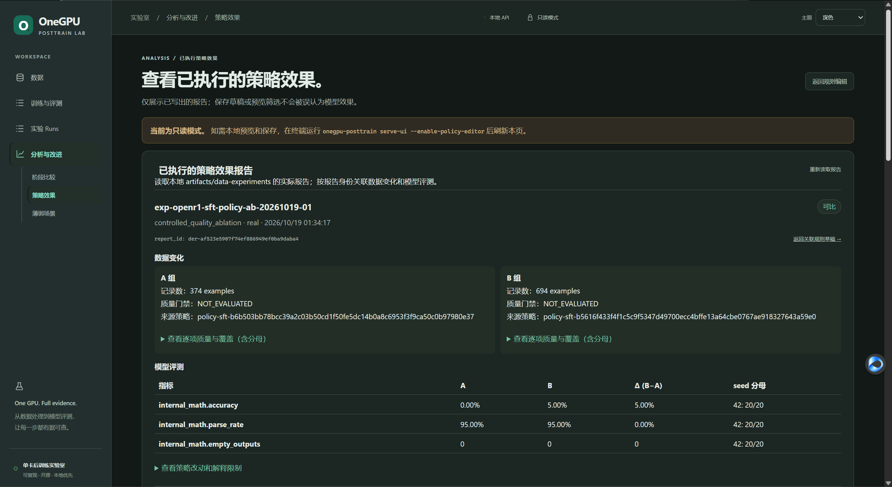

# OneGPU-PostTrain

[](https://www.python.org/)
[](LICENSE)
[](#hardware-target)
[](docs/project/IMPLEMENTATION_STATUS.md)

**English** | [简体中文](README_zh.md)

> **Run and compare small-model post-training experiments on one consumer GPU.**
>
> OneGPU-PostTrain wraps **ms-swift** with data quality gates, run lineage, unified evaluation, and resource tracking across **PEFT-CPT → SFT → DPO / SimPO / GRPO**.

Built for practitioners who want to understand how data, training recipes, and compute limits affect an experiment—not only launch a trainer.

- **Preview before you run:** inspect the planned commands and inputs before allocating GPU memory.
- **Trace each result:** connect datasets, configs, seeds, checkpoints, and resource metrics to a run.
- **Compare consistently:** evaluate stages and recipes with shared protocols and explicit limitations.

**Start here:** [CPU-only checks](docs/guides/QUICKSTART.md#2-cpu-only-developer-validation) · [Run on a CUDA GPU](docs/guides/QUICKSTART.md#6-run-the-complete-smoke-pipeline)



*Local policy A/B report example: 20 evaluation examples per seed, with quality gates marked `NOT_EVALUATED`. It demonstrates evidence reporting and limitations, not a model-quality conclusion.*

Target release: **v0.1**  
Current implementation: **0.1.0.dev6**  
Design revision: **v0.1.1 frozen for product release v0.1**

## Why this project?

Training frameworks already know how to run CPT, SFT, DPO, SimPO and GRPO. The missing piece for many practitioners is a compact experiment system that answers:

- What data does each stage consume?
- What actually changes after each stage?
- Does lower training loss improve downstream capability?
- How do DPO and SimPO differ under the same parent model, data and budget?
- What changes when GRPO reward design or generation count changes?
- Which recipes really fit in **8 GB VRAM**?
- Can every result be reproduced from a dataset manifest, config, seed and checkpoint lineage?

OneGPU-PostTrain therefore connects data processing and quality to training, evaluation and controlled experiments:

```text
Raw Data → Processing & Quality → Training → Evaluation → Controlled Experiments
```

It is **not** a replacement for ms-swift. ms-swift is the training engine; OneGPU-PostTrain is the reproducible experiment layer around it.

Data quality is a first-class part of that experiment layer: each stage needs stage-appropriate evidence for structure, semantics, distribution and leakage—not just a sample count. The build report records the processing steps and rejection reasons; dataset lineage connects those quality changes to runs, models and evaluations. Controlled experiments are needed to assess whether a cleaning policy changes model outcomes. See the [Data Quality Design](docs/design/DATA_QUALITY_DESIGN.md) for the report contract and rollout plan.

The detailed schemas, comparison types and delivery plan are in [Data Processing, Quality Change, and Model Effect Design](docs/design/DATA_PROCESSING_EFFECT_DESIGN.md).

## Pipeline

```text
Qwen3-0.6B-Base
        │
        ▼
     PEFT-CPT ─────────────── Full-CPT feasibility probe
        │
        ▼
      M1-CPT
        │
        ▼
       SFT
        │
        ▼
      M2-SFT
        │
        ├──────── DPO ───────────────→ M3-DPO
        ├──── SimPO-original ────────→ M3-SimPO
        ├──── GRPO-standard ─────────→ M3-GRPO-standard
        └──── GRPO-lowmem ───────────→ M3-GRPO-lowmem
                         │
                         ▼
              Unified Evaluation
                         │
                         ▼
              Controlled Comparison
```

The alignment/RL branches start from the **same merged M2-SFT checkpoint**. They are parallel experiments, not a default `DPO → SimPO → GRPO` chain.

## What is implemented?

| Area | Status | Notes |
|---|---|---|
| Design revision v0.1.1 | ✅ | Frozen architecture, data, training, evaluation and experiment contracts for product release v0.1 |
| FineMath / OpenR1 data build | ✅ | Streaming/local JSONL, deterministic splits, gates and reports |
| Benchmark decontamination | ✅ | Applied before OpenR1 split; CPT contamination is reported |
| Canonical → ms-swift adapter | ✅ | CPT, SFT, preference and GRPO formats |
| Base evaluation | ✅ code | EvalScope + internal holdout + domain PPL |
| PEFT-CPT / M1 merge | ✅ code | 20-step smoke recipe |
| Full-CPT probe | ✅ code | 5-step diagnostic, `PASS / OOM / FAILED` |
| SFT / M2 merge | ✅ code | Fresh LoRA stage from merged M1 |
| DPO | ✅ code | Held-out preference evaluation included |
| SimPO-original | ✅ code | Explicit `cpo_alpha=0.0` |
| GRPO-standard | ✅ code | `beta=0.04`, reference model enabled |
| GRPO-lowmem | ✅ code | `beta=0`, reference model disabled |
| End-to-end smoke orchestration | ✅ code | Plan + execute + summary scripts |
| Real RTX 4060 smoke | ✅ | Completed 2026-10-15; Mini/OVAT remain outstanding. Smoke feasibility does not establish algorithm quality. |

See [Implementation Status](docs/project/IMPLEMENTATION_STATUS.md) and the [Development Plan](docs/project/DEVELOPMENT_PLAN.md) for current gates. The current milestone is [dev7 Smoke Hardening](docs/project/milestones/v0.1-dev7-hardening.md).

## Hardware target

The reference environment for v0.1 is:

```text
GPU:       NVIDIA RTX 4060 8GB
GPU count: 1
Python:    3.10–3.12
Model:     Qwen3-0.6B-Base
```

The official CPT path is **PEFT-CPT**. Full-parameter CPT is deliberately kept as a diagnostic probe. An OOM from the Full-CPT probe or GRPO-standard is treated as a valid 8 GB feasibility result, not silently hidden.

## Reference stack

- Training engine: **ms-swift 4.5.3**
- Evaluation: **EvalScope 1.12.0** + project evaluators
- Math verification: **math-verify 0.9.0**
- Base model: **Qwen3-0.6B-Base**
- CPT corpus: **FineMath-4+**
- SFT / Preference / GRPO source: **OpenR1-Math-220k**

Exact project pins live in [`pyproject.toml`](pyproject.toml).

## Quick start

### 1. CPU-only repository validation

This path does not require CUDA and is useful before touching training dependencies.

```bash
git clone <your-repository-url>
cd onegpu-posttrain

python -m venv .venv
# Linux/macOS
source .venv/bin/activate
# Windows PowerShell: .venv\Scripts\Activate.ps1

pip install -e '.[dev]'
pytest

onegpu-posttrain doctor
onegpu-posttrain validate-example-data data/examples
```

### 2. Inspect the full smoke plan

No model is loaded and no training is started:

```bash
scripts/smoke_pipeline_plan.sh
```

### 3. Run on the target CUDA machine

```bash
pip install -e '.[all]'

scripts/build_smoke_data.sh
scripts/smoke_pipeline.sh
```

The full walkthrough, expected artifacts and troubleshooting rules are in [Quick Start](docs/guides/QUICKSTART.md).

### Opt-in local Mini SFT launcher

The UI can launch only the reviewed exploratory Mini SFT recipe at `recipes/mini/23-sft-1024-fallback.yaml` (307 examples, 1,024-token limit, seed 42). Install the UI and training extras, then start the service on loopback:

```bash
pip install -e '.[ui,train]'
onegpu-posttrain serve-ui --workspace . --enable-experiment-launcher
```

Open `http://127.0.0.1:8765/` and use **Training Launcher**. The launcher performs a read-only preflight and requires explicit confirmation; it does not download missing inputs, accept parameter/path overrides, or start evaluation. This data is exploratory and has not passed semantic-quality review. Historical RTX 4060 peak VRAM was about 7,939/8,188 MiB, so OOM remains possible. Closing the browser leaves the server-side run active; stopping the UI service requests process-group termination and records an unfinished run as interrupted. After success, replace `<run_id>` with the displayed execution ID and explicitly evaluate the merged model:

```bash
onegpu-posttrain plan-model-eval --model "runs/mini/ui-launcher/<run_id>/merged/M2-SFT" --stage sft --run-label "<run_id>-eval" --output "runs/mini/ui-launcher/<run_id>/evaluation"
onegpu-posttrain run-model-eval  --model "runs/mini/ui-launcher/<run_id>/merged/M2-SFT" --stage sft --run-label "<run_id>-eval" --output "runs/mini/ui-launcher/<run_id>/evaluation"
```

Do not use `--allow-remote` with the launcher; remote launcher mode is refused.

## Data design

OneGPU-PostTrain keeps a framework-neutral **Canonical Schema** and converts it to ms-swift only at the training boundary.

```text
FineMath-4+
    ↓
CPT train / document-level PPL holdout

OpenR1-Math
    ↓
normalize → deduplicate → decontaminate → verifiability gates
    ↓
problem-level split
    ├── SFT pool
    ├── alignment pool
    │     ├── preference train
    │     └── GRPO prompts
    └── holdout pool
          ├── internal math eval
          └── held-out preference eval
```

Important rules:

- Split by **problem**, not by already-transformed stage records.
- SFT and alignment pools are separated.
- DPO and SimPO use exactly the same preference pairs.
- Preference training pairs and held-out preference pairs have zero `problem_id` overlap.
- Long OpenR1 reasoning traces are filtered by rendered-token eligibility; they are not silently truncated.
- Preference negatives must be complete, parseable and length-controlled rather than garbage failures.
- GRPO uses only samples with a stable programmatic ground-truth verification path.

See [Data Design](docs/design/v0.1.1/01-data-design.md) and [Smoke Data Build](docs/implementation/data/SMOKE_DATA_BUILD.md).

## Unified evaluation

A checkpoint is not considered an official stage result until it has passed the shared evaluation protocol.

| Metric family | Base | CPT | SFT | DPO | SimPO | GRPO |
|---|:---:|:---:|:---:|:---:|:---:|:---:|
| GSM8K / MATH-500 | ✓ | ✓ | ✓ | ✓ | ✓ | ✓ |
| Internal math accuracy | ✓ | ✓ | ✓ | ✓ | ✓ | ✓ |
| FineMath domain PPL | ✓ | ✓ | optional | optional | optional | optional |
| Format / parseability | – | – | ✓ | ✓ | ✓ | ✓ |
| Held-out policy pair metrics | – | – | ✓ | ✓ | ✓ | – |
| GRPO reward components | – | – | – | – | – | ✓ |
| KL | – | – | – | – | – | standard profile |
| Peak VRAM / wall time | – | ✓ | ✓ | ✓ | ✓ | ✓ |

DPO and SimPO are compared with a framework-independent held-out metric:

```text
policy_pair_accuracy = P(score(chosen) > score(rejected))

score(response | prompt)
= mean conditional log-probability over response tokens only
```

This avoids comparing trainer-specific reward scales.

## GRPO reward contract

The v0.1 reward is intentionally simple and inspectable:

```text
total_reward
= 1.0 × accuracy
+ 0.1 × boxed_format
```

- `accuracy`: mathematical answer correctness using the same extraction/equivalence semantics as evaluation.
- `boxed_format`: whether the final answer follows `\boxed{...}`.
- Reward components are logged separately.
- A higher training reward alone is **not** considered a capability improvement.

See [GRPO Rewards](docs/implementation/rl/GRPO_REWARDS.md).

## Experiment methodology

The first official experiments use **One Variable At A Time (OVAT)**:

| Experiment | Variable |
|---|---|
| CPT dataset size | 5M / 10M / 20M tokens |
| SFT learning rate | low / medium / high |
| DPO beta | controlled beta sweep |
| DPO vs SimPO | algorithm only |
| GRPO generations | `G=2` vs `G=4` |
| GRPO reward | accuracy vs accuracy + format |

Every run should preserve:

```text
model revision
parent checkpoint
sample IDs / dataset manifest
training config
seed
prompt version
reward version
evaluation protocol
hardware / dependency versions
git commit
```

See [Experiment Design](docs/design/v0.1.1/04-experiment-design.md).

## Results policy

**There are intentionally no fabricated benchmark numbers in this README.**

Verified RTX 4060 results will be published under [`docs/results/`](docs/results/README.md) only when the run artifacts are available. Smoke runs answer feasibility and instrumentation questions; they are not an algorithm leaderboard.

## Repository layout

```text
.
├── configs/                 # model/data/evaluation configs
├── data/                    # canonical examples and manifests
├── docs/
│   ├── design/              # frozen design records
│   │   └── frontend/         # planned UI product, IA, page specs and roadmap
│   ├── implementation/      # stage implementation docs
│   ├── guides/              # user-facing guides
│   ├── experiments/         # future verified OVAT reports
│   ├── results/             # future verified hardware results
│   └── project/             # status and implementation changelog
├── plugins/                 # ms-swift external reward plugins
├── recipes/smoke/           # frozen smoke recipes
├── scripts/                 # plan/execute orchestration
├── src/onegpu_posttrain/    # project package
└── tests/                   # CPU-safe contract tests
```

## Documentation

Start at the [Product Vision](docs/design/PRODUCT_VISION.md) for the project north star ([中文](docs/design/PRODUCT_VISION_zh.md)), then use [`docs/README.md`](docs/README.md) as the documentation index. The [System Architecture](docs/design/SYSTEM_ARCHITECTURE.md) and [Open-Source Release Plan](docs/project/OPEN_SOURCE_PLAN.md) also have [Chinese versions](docs/design/SYSTEM_ARCHITECTURE_zh.md) and [Chinese release plan](docs/project/OPEN_SOURCE_PLAN_zh.md).

Recommended reading order:

1. [Overall Design](docs/design/v0.1.1/00-overall-design.md)
2. [Data Design](docs/design/v0.1.1/01-data-design.md)
3. [Training Recipe Design](docs/design/v0.1.1/02-training-recipe-design.md)
4. [Evaluation Design](docs/design/v0.1.1/03-evaluation-design.md)
5. [Experiment Design](docs/design/v0.1.1/04-experiment-design.md)
6. [Quick Start](docs/guides/QUICKSTART.md)
7. [Implementation Status](docs/project/IMPLEMENTATION_STATUS.md)
8. [Development Plan](docs/project/DEVELOPMENT_PLAN.md)
9. [System Architecture](docs/design/SYSTEM_ARCHITECTURE.md)
10. [Open-Source Release Plan](docs/project/OPEN_SOURCE_PLAN.md)

## Roadmap

The version labels below are product releases; design revision v0.1.1 is the frozen specification for product release v0.1.

```text
v0.1   Single-GPU full smoke + Mini experiment baseline (CLI-only)
v0.1.1 Read-only experiment UI
v0.2   1B/3B models + local experiment launcher
v0.3   Data-centric experiments + Experiment Studio
v0.4+  Alignment/RL breadth + registry UI foundations
v0.5   Data Flywheel / Model Flywheel experiments
v0.6   Agent / Tool RL
v1.0   Reproducible Post-Training Research Platform
```

See the [frontend roadmap](docs/design/frontend/FRONTEND_ROADMAP.md) for UI scope and gates. The read-only Data page is an early preview; the complete UI release remains planned.

See [`ROADMAP.md`](ROADMAP.md) for release gates.

## Project history and citation

- [`CHANGELOG.md`](CHANGELOG.md) — release-level history
- [`CITATION.cff`](CITATION.cff) — software citation metadata

## Contributing

Issues, reproducibility reports, new recipes and experiment reports are welcome. Please read [`CONTRIBUTING.md`](CONTRIBUTING.md) before submitting a pull request.

When contributing results, include the raw run artifacts and environment metadata. Do not submit benchmark tables without reproducible provenance.

## License and third-party data

Project code and documentation are licensed under the [Apache License 2.0](LICENSE).

Datasets, models and third-party libraries retain their own licenses. See [`THIRD_PARTY_LICENSES.md`](THIRD_PARTY_LICENSES.md).

---

**Don't just run post-training. Understand it.**
