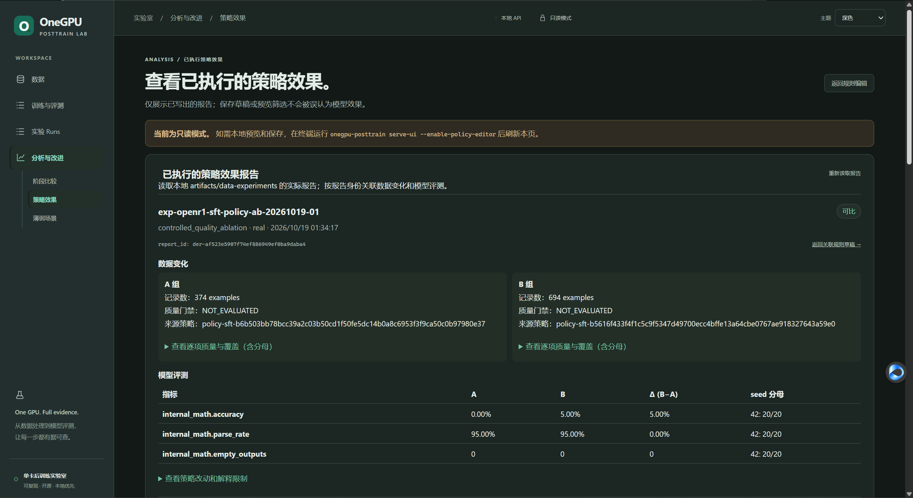

# OneGPU-PostTrain

[](https://www.python.org/)
[](LICENSE)
[](#硬件目标)
[](docs/project/IMPLEMENTATION_STATUS.md)

[English](README.md) | **简体中文**

> **用一张消费级 GPU，运行并比较小模型后训练实验。**
>
> OneGPU-PostTrain 在 **ms-swift** 之上提供数据质量门禁、运行血缘、统一评测和资源记录，覆盖 **PEFT-CPT → SFT → DPO / SimPO / GRPO**。

适合希望弄清数据、训练配方和算力限制如何影响实验结果的实践者，而不只是启动一个 Trainer。

- **运行前先预览：** 查看计划命令和输入，再决定是否占用 GPU。
- **结果可追溯：** 将数据集、配置、随机种子、检查点和资源指标关联到每次运行。
- **比较有依据：** 使用统一协议比较训练阶段和配方，并明确结果限制。

**从这里开始：**[无需 GPU 的检查](docs/guides/QUICKSTART.md#2-cpu-only-developer-validation) · [在 CUDA GPU 上运行](docs/guides/QUICKSTART.md#6-run-the-complete-smoke-pipeline)



*本地策略 A/B 报告示例：每个 seed 使用 20 条评测样本，质量门禁标记为 `NOT_EVALUATED`。图片用于展示证据记录与限制，不构成模型质量或策略优劣结论。*

目标发布版本：**v0.1**  
当前实现版本：**0.1.0.dev6**  
设计修订版：**v0.1.1，针对产品发布版 v0.1 冻结**

## 为什么做这个项目？

现有训练框架已经能运行 CPT、SFT、DPO、SimPO、GRPO，但对学习和研究来说，真正缺的往往不是又一个 Trainer，而是一套可以回答这些问题的实验系统：

- 每个训练阶段到底吃什么数据？
- Base → CPT → SFT → Alignment 后模型究竟改变了什么？
- `train_loss` 更低是否真的意味着下游能力更强？
- 在相同父模型、相同数据、相同预算下，DPO 和 SimPO 有什么区别？
- GRPO 的 reward 或 generation 数改变后会发生什么？
- 哪些训练方案真的能在 **8GB 显存**上运行？
- 一个实验结果能否从数据版本、配置、seed、checkpoint lineage 完整复现？

因此 OneGPU-PostTrain 的核心不是重写 Trainer，而是：

```text
原始数据 → 处理与质量评估 → 训练 → 评测 → 受控实验
```

**ms-swift 是训练引擎，OneGPU-PostTrain 是实验层。**

数据质量是实验层的一条主线：每个阶段都需要适合该阶段的结构、语义、分布和泄漏证据，不能只有样本数量。数据构建报告记录处理步骤和拒绝原因；数据血缘把质量变化连接到训练 run、模型和评测。只有受控实验才能检验某种清洗策略是否改变模型结果。报告契约和落地顺序见[数据质量设计](docs/design/DATA_QUALITY_DESIGN_zh.md)。

artifact schema、效果比较类型和分阶段交付方案见[数据处理、质量变化与模型效果详细设计](docs/design/DATA_PROCESSING_EFFECT_DESIGN_zh.md)。

## 完整训练链路

```text
Qwen3-0.6B-Base
        │
        ▼
     PEFT-CPT ─────────────── Full-CPT 可行性探针
        │
        ▼
      M1-CPT
        │
        ▼
       SFT
        │
        ▼
      M2-SFT
        │
        ├──────── DPO ───────────────→ M3-DPO
        ├──── SimPO-original ────────→ M3-SimPO
        ├──── GRPO-standard ─────────→ M3-GRPO-standard
        └──── GRPO-lowmem ───────────→ M3-GRPO-lowmem
                         │
                         ▼
                    统一评测
                         │
                         ▼
                    受控实验对比
```

DPO、SimPO、GRPO 默认都是从**同一个 merged M2-SFT** 出发的平行实验，不采用 `DPO → SimPO → GRPO` 串联作为主实验。

## 当前完成度

| 能力 | 状态 | 说明 |
|---|---|---|
| 设计修订版 v0.1.1 | ✅ | 面向产品发布版 v0.1 的数据、训练、评测、实验设计已冻结 |
| FineMath / OpenR1 数据构建 | ✅ | Streaming / 本地 JSONL、确定性 split、门禁与报告 |
| Benchmark contamination | ✅ | OpenR1 在 split 前处理；CPT 额外报告污染风险 |
| Canonical → ms-swift | ✅ | CPT / SFT / Preference / GRPO |
| Base Evaluation | ✅ 代码完成 | EvalScope + Internal Holdout + Domain PPL |
| PEFT-CPT / M1 merge | ✅ 代码完成 | 20-step Smoke |
| Full-CPT probe | ✅ 代码完成 | 5-step，`PASS / OOM / FAILED` |
| SFT / M2 merge | ✅ 代码完成 | merged M1 上 fresh LoRA |
| DPO | ✅ 代码完成 | 含 held-out Preference Eval |
| SimPO-original | ✅ 代码完成 | 显式 `cpo_alpha=0.0` |
| GRPO-standard | ✅ 代码完成 | `beta=0.04`，有 reference model |
| GRPO-lowmem | ✅ 代码完成 | `beta=0`，无 reference model |
| End-to-End Smoke | ✅ 代码完成 | plan / execute / summary |
| RTX 4060 Smoke 实测 | ✅ | 2026-10-15 已完成；Mini/OVAT 尚未完成 |

完整状态见：[Implementation Status](docs/project/IMPLEMENTATION_STATUS.md) 和[开发计划](docs/project/DEVELOPMENT_PLAN.md)。当前执行 [dev7 Smoke Hardening](docs/project/milestones/v0.1-dev7-hardening.md)。真实 Smoke 仅用于验证流程可执行，不代表算法质量结论。

## 硬件目标

v0.1 的参考环境：

```text
GPU:       NVIDIA RTX 4060 8GB
GPU 数量:  1
Python:    3.10–3.12
Base:      Qwen3-0.6B-Base
```

官方 CPT 路径是 **PEFT-CPT**。Full-CPT 只做诊断型可行性测试。如果 Full-CPT 或 GRPO-standard 在 8GB 上 OOM，这本身就是正式的工程实验结论，而不是需要隐藏的失败。

## 技术基线

- Training Engine：**ms-swift 4.5.3**
- Evaluation：**EvalScope 1.12.0** + 自定义 evaluator
- Math Verify：**math-verify 0.9.0**
- Base Model：**Qwen3-0.6B-Base**
- CPT：**FineMath-4+**
- SFT / Preference / GRPO：**OpenR1-Math-220k**

精确依赖以 [`pyproject.toml`](pyproject.toml) 为准。

## 快速开始

### 1. 不需要 GPU 的工程检查

```bash
git clone <your-repository-url>
cd onegpu-posttrain

python -m venv .venv
source .venv/bin/activate
# Windows PowerShell: .venv\Scripts\Activate.ps1

pip install -e '.[dev]'
pytest

onegpu-posttrain doctor
onegpu-posttrain validate-example-data data/examples
```

### 2. 只看 Smoke 全流程计划，不训练

```bash
scripts/smoke_pipeline_plan.sh
```

### 3. 在 RTX 4060 / CUDA 环境真正执行

```bash
pip install -e '.[all]'

scripts/build_smoke_data.sh
scripts/smoke_pipeline.sh
```

详细步骤、产物和故障处理见：[Quick Start](docs/guides/QUICKSTART.md)。

### 显式启用本地 Mini SFT Launcher

前端目前只允许启动经过验证的探索性 Mini SFT 配方 `recipes/mini/23-sft-1024-fallback.yaml`（307 条、1,024-token 上限、seed 42）。安装 UI 与训练依赖后，在 loopback 本机启动：

```bash
pip install -e '.[ui,train]'
onegpu-posttrain serve-ui --workspace . --enable-experiment-launcher
```

打开 `http://127.0.0.1:8765/`，进入“训练 Launcher”。系统先执行只读预检，再要求用户明确确认；不会自动下载缺失输入、不接受路径/参数覆盖，也不会启动评测。该数据仍是探索性数据，语义质量尚未审核。RTX 4060 历史峰值约为 7,939/8,188 MiB，仍可能 OOM。关闭浏览器不会停止服务端训练；关闭 UI 服务会请求停止训练进程组，并将未完成任务记录为 `interrupted`。SFT 成功后，把界面显示的 run ID 替换到下方命令，显式评测 merged model：

```bash
onegpu-posttrain plan-model-eval --model "runs/mini/ui-launcher/<run_id>/merged/M2-SFT" --stage sft --run-label "<run_id>-eval" --output "runs/mini/ui-launcher/<run_id>/evaluation"
onegpu-posttrain run-model-eval  --model "runs/mini/ui-launcher/<run_id>/merged/M2-SFT" --stage sft --run-label "<run_id>-eval" --output "runs/mini/ui-launcher/<run_id>/evaluation"
```

Launcher 不允许配合 `--allow-remote` 远程开放。

### 本地模型体验

启用上述本机 Launcher 后，可在“训练与评测 → 模型体验”选择 lineage 与内容摘要已核验的 Base / merged 阶段模型进行多轮对话，也可将同一问题顺序提交给最多 3 个模型比较。体验与训练、正式评测共用 GPU 独占锁；对照会逐个加载、生成并卸载模型。聊天提示词和回答仅保存在服务进程内存中，不写入 Run、日志、评测结果或训练数据。输出仅用于定性观察，不能视为正确性证明或正式评测分数。详情见[本地模型体验指南](docs/guides/MODEL_PLAYGROUND_zh.md)。

## 数据设计

项目内部先生成**框架无关 Canonical Data**，真正训练前才适配 ms-swift。

```text
FineMath-4+
    ↓
CPT Train / Document-level PPL Holdout

OpenR1-Math
    ↓
Normalize → Dedup → Decontaminate → Verifier/Length Gates
    ↓
Problem-level Split
    ├── SFT Pool
    ├── Alignment Pool
    │     ├── Preference Train
    │     └── GRPO Prompts
    └── Holdout Pool
          ├── Internal Math Eval
          └── Held-out Preference Eval
```

关键规则：

- **先按问题 split，再生成不同阶段格式**；
- SFT Pool 与 Alignment Pool 分离；
- DPO / SimPO 使用完全相同的数据；
- Preference Train 与 Preference Eval 的 `problem_id` 零重叠；
- OpenR1 长 CoT 先做真实 tokenizer Length Gate，不训练时偷偷 truncation；
- rejected 必须是完整、可解析、长度可控的错误回答，而不是垃圾失败；
- GRPO 只进入可以稳定程序验证 ground truth 的数学样本。

详细见：[Data Design](docs/design/v0.1.1/01-data-design.md)。

## 统一评测

我们不接受“训练成功 = 模型变好”。每个正式 Stage Result 都必须经过统一评测。

| 指标 | Base | CPT | SFT | DPO | SimPO | GRPO |
|---|:---:|:---:|:---:|:---:|:---:|:---:|
| GSM8K / MATH-500 | ✓ | ✓ | ✓ | ✓ | ✓ | ✓ |
| Internal Math Accuracy | ✓ | ✓ | ✓ | ✓ | ✓ | ✓ |
| Domain PPL | ✓ | ✓ | 可选 | 可选 | 可选 | 可选 |
| Format / Parseability | – | – | ✓ | ✓ | ✓ | ✓ |
| Held-out Preference | – | – | ✓ | ✓ | ✓ | – |
| GRPO Reward Components | – | – | – | – | – | ✓ |
| KL | – | – | – | – | – | standard |
| VRAM / Wall Time | – | ✓ | ✓ | ✓ | ✓ | ✓ |

DPO / SimPO 的公共比较指标不使用各自 trainer 的 reward，而是：

```text
policy_pair_accuracy
= P(score(chosen) > score(rejected))

score(response | prompt)
= response token 的平均条件 log-prob
```

这样两种算法的指标处在同一个尺度上。

## GRPO Reward

v0.1 固定为一个刻意简单、可解释的 Reward：

```text
total_reward
= 1.0 × accuracy
+ 0.1 × boxed_format
```

同时单独记录每个 component。**Reward 上升不等于模型真实能力一定上升。**

详细见：[GRPO Reward](docs/implementation/rl/GRPO_REWARDS.md)。

## 实验方法

第一阶段采用 **OVAT（One Variable At A Time）**：

| 实验 | 单变量 |
|---|---|
| CPT Data Size | 5M / 10M / 20M tokens |
| SFT Learning Rate | low / medium / high |
| DPO Beta | beta sweep |
| DPO vs SimPO | 只改变算法 |
| GRPO Generations | `G=2` vs `G=4` |
| GRPO Reward | accuracy vs accuracy + format |

每个结果必须能追溯：

```text
Model Revision
Parent Checkpoint
Dataset Manifest / Sample IDs
Training Config
Seed
Prompt Version
Reward Version
Evaluation Protocol
Hardware / Dependency Versions
Git Commit
```

## 结果发布原则

**README 当前故意没有任何虚构 benchmark 数字。**

只有真实 RTX 4060 run artifact 存在后，结果才会进入 [`docs/results/`](docs/results/README.md)。Smoke 用于验证流程和资源可行性，不作为算法排行榜。

## 项目目录

```text
.
├── configs/
├── data/
├── docs/
│   ├── design/
│   ├── implementation/
│   ├── guides/
│   ├── experiments/
│   ├── results/
│   ├── design/
│   │   └── frontend/         # 前端产品、信息架构、页面规格与路线图（规划中）
│   └── project/
├── plugins/
├── recipes/smoke/
├── scripts/
├── src/onegpu_posttrain/
└── tests/
```

## 文档

项目愿景：[产品愿景](docs/design/PRODUCT_VISION_zh.md)（[English](docs/design/PRODUCT_VISION.md)）；系统总设计：[中文](docs/design/SYSTEM_ARCHITECTURE_zh.md) / [English](docs/design/SYSTEM_ARCHITECTURE.md)；文档统一入口：[docs/README.md](docs/README.md)

推荐阅读：

1. [总体设计](docs/design/v0.1.1/00-overall-design.md)
2. [数据设计](docs/design/v0.1.1/01-data-design.md)
3. [训练设计](docs/design/v0.1.1/02-training-recipe-design.md)
4. [评测设计](docs/design/v0.1.1/03-evaluation-design.md)
5. [实验设计](docs/design/v0.1.1/04-experiment-design.md)
6. [Quick Start](docs/guides/QUICKSTART.md)
7. [Implementation Status](docs/project/IMPLEMENTATION_STATUS.md)
8. [Development Plan](docs/project/DEVELOPMENT_PLAN.md)
9. [Frontend Roadmap](docs/design/frontend/FRONTEND_ROADMAP.md)
10. [System Architecture](docs/design/SYSTEM_ARCHITECTURE.md)
11. [Open-Source Release Plan](docs/project/OPEN_SOURCE_PLAN.md)
12. [前端产品设计](docs/design/frontend/FRONTEND_PRODUCT_DESIGN_zh.md)
13. [前端页面规格](docs/design/frontend/PAGE_SPEC_zh.md)
14. [分版本开源计划](docs/project/OPEN_SOURCE_PLAN_zh.md)

## Roadmap

以下版本号是产品发布版本；设计修订版 v0.1.1 是为产品发布版 v0.1 冻结的实验设计。

```text
v0.1   单卡 Smoke + Mini 实验基线（CLI-only）
v0.1.1 只读实验可视化 UI
v0.2   1B/3B + 本地实验启动器
v0.3   数据中心实验 + Experiment Studio
v0.4+  Alignment/RL 扩展 + Registry UI 基础
v0.5   Data Flywheel / Model Flywheel
v0.6   Agent / Tool RL
v1.0   Reproducible Post-Training Research Platform
```

详细见 [`ROADMAP.md`](ROADMAP.md)。
前端路线详见[中文路线图](docs/design/frontend/FRONTEND_ROADMAP_zh.md)。只读 Data 工作台与显式启用的固定 Mini SFT Launcher 已实现；更广泛的配方选择/参数编辑仍按路线图单独评审。

## 版本记录与引用

- [`CHANGELOG.md`](CHANGELOG.md) — Release 级变更记录
- [`CITATION.cff`](CITATION.cff) — 软件引用元数据

## Contributing

欢迎提交问题、可复现实验结果、新 Recipe 和改进建议。提交代码前请阅读 [`CONTRIBUTING.md`](CONTRIBUTING.md)。

实验结果 PR 必须带 run artifact / 环境元数据，不接受只有成绩表、没有可复现来源的结果。

## License

项目代码和文档使用 [Apache License 2.0](LICENSE)。

模型、数据集和第三方依赖保留各自许可证，见 [`THIRD_PARTY_LICENSES.md`](THIRD_PARTY_LICENSES.md)。

---

**Don't just run post-training. Understand it.**
