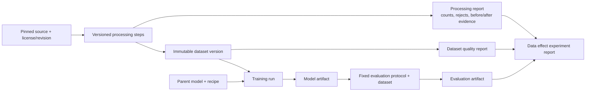

# Data Processing, Quality Change, and Model Effect Design

**Status:** Detailed design; policy/preview/registration/conservative comparison, editor and targeted-synthetic UI preparation slice are implemented; official Mini quality gates and real controlled model-effect evidence remain incomplete  
**Scope:** Trace source data processing, assess each official dataset, and test whether a declared processing policy changes downstream model outcomes.

Processing traces, static quality, policy identity, deterministic split, local preview/build, experiment registration, conservative comparison, and the Data policy editor have CPU-validated implementations. A model effect is calculated only from preregistered exact lineage and compatible budgets/evaluation evidence; the owned-fixture example remains `NOT_EVALUATED`. Mini data readiness still has SFT/Preference quota and quality gaps and is not a completed training baseline. See [implementation and limits](../implementation/data/DATA_EVIDENCE.md) and the [policy experiment guide](../guides/POLICY_EXPERIMENT_UI_zh.md). Types are in `src/onegpu_posttrain/data/policy.py`, `policy_experiment.py` and `src/onegpu_posttrain/lineage.py`.

中文版本：[数据处理、质量变化与模型效果设计](DATA_PROCESSING_EFFECT_DESIGN_zh.md)。

The bounded targeted-data workbench is now an early UI slice: it shows scenario denominators and evidence identity, edits provider/prompt/output draft fields without a secret-value field, exports a local non-registered draft, and summarizes generation/validation/effect reports through a read-only allowlist. It does not issue provider requests or launch training. The implementation and operator path are tracked in [`targeted-synthetic-data`](../../openspec/changes/targeted-synthetic-data/proposal.md) and the [Chinese targeted-data guide](../guides/TARGETED_SYNTHETIC_DATA_zh.md). No real provider/GPU/model-gain evidence is implied.

## 1. Product question and boundary

The feature should let a user follow one evidence chain:

```text
Source data
  → ordered transforms and gates
  → dataset versions + quality evidence
  → training runs + model artifacts
  → fixed evaluations
  → pipeline-effect or controlled-policy comparison
```

It answers two separate questions:

1. What changed in the data at each build step, including what was removed and why?
2. Did applying the complete pipeline or one selected policy change model metrics under declared controls?

The first is a data-build observation. The second requires training and evaluation runs. A quality increase alone does not establish a model improvement or explain why it occurred.

This design extends the [stage-specific Data Quality Design](DATA_QUALITY_DESIGN.md), [Lineage Design](LINEAGE_DESIGN.md), frozen [v0.1.1 Data Design](v0.1.1/01-data-design.md) and [Experiment Design](v0.1.1/04-experiment-design.md). It does not silently revise the frozen data gates. Any eligibility or ordering change requires an explicit protocol version and rebuilt datasets.

## 2. System flow and ownership



| Object | Responsibility |
|---|---|
| `processing_report.json` | Ordered build steps, inputs/outputs, counts with units, first-rejection reasons, available step-level quality snapshots, durations and references. One report per build invocation. |
| `dataset_manifest.json` | Immutable dataset identity, parents, source/revision/license, split, content digest, processing-report reference and final quality-report reference. |
| `quality_report.json` | Assessment of one dataset version under a named quality protocol. Reassessment creates a new report identity; it does not mutate dataset identity. |
| `data_effect_experiment.json` | Declared pipeline-effect or controlled-policy question, treatment/control datasets, model/recipe/budget/seeds/evaluation contract and compatibility rules. |
| `data_effect_report.json` | Run/evaluation outcomes, data-quality deltas, model-metric deltas, cost and limitations for the registered comparison. |

Keep reports as local, portable JSON/Markdown artifacts. Do not require a database, hosted tracker, or third-party data-quality service. Reuse canonical Pydantic record schemas and the existing report-writing conventions; optional framework adapters write into this contract.

## 3. Processing protocol and trace

### 3.1 Required step semantics

Every build report includes `schema_version`, `build_id`, `processing_protocol`, source references, creation time, code/checker versions where available, and an ordered `processing_steps` array. Start/end timings remain unavailable until instrumented. Each step records:

- stable `step_id`, `order`, operation name/version, operation kind (`transform`, `filter`, `split`, `verify`, `sample`, `tokenize`, `export`) and status; the report-level config digest binds all steps in the initial implementation;
- input/output references and counts with explicit units (`raw_rows`, `documents`, `unique_problems`, `examples`, `preference_pairs`, `prompts`, `tokens`);
- accepted/rejected counts and `first_rejection_reasons`, tied to the documented rule order;
- before/after metrics where they are measurable and comparable, each with method/version, numerator/denominator, sample method/coverage and status;
- duration and resource use when available; content digest for materialized outputs; explicit unknown/skipped reason otherwise.

Counts must reconcile where units and semantics permit. A rule's rejection count means the first failing rule for each record in an ordered gate chain; it does not estimate the independent causal contribution of that rule. Do not calculate retention across different units or where output is not a subset of input. Pair creation, chunking, packing and tokenization can change units.

Intermediate records need not all be written to disk. Assign a `DatasetArtifact` ID and manifest to any intermediate output that is materialized, reused, or consumed by a run. For in-memory pools use a namespaced logical reference such as `pool:verified_math`; never present it as a durable dataset. Optional accepted/rejected record-ID sidecars must avoid source text and comply with upstream terms.

### 3.2 Initial builder step maps

The trace reports actual implementation order, rather than a generic assumed order. Current smoke implementations are the starting map:

| OpenR1 step | Main output/evidence |
|---|---|
| Read bounded/pinned source rows | raw rows read, source revision, cap/exhaustion/target stop reason |
| Normalize problem and derive `problem_id` | empty/malformed rows, normalized count |
| Exact problem deduplication | duplicate count and stable IDs |
| Benchmark decontamination | exact/fuzzy hits, removed candidates, benchmark revision/protocol |
| Verifier-supported math core | verifier support/correctness coverage and rejected unsupported/no-correct-trace counts |
| Deterministic problem-level pool assignment | SFT/alignment/holdout IDs, seed and overlap checks |
| Stage builders and tokenizer-rendered gates | SFT eligibility; preference pair validity and length ratio; GRPO prompt eligibility; holdout construction |
| Canonical serialization / optional adapter export | record counts, units, hashes, adapter source identity |

FineMath follows a different sequence: read/validate text, derive stable document ID and document-level split, run the secondary contamination scan, chunk with the pinned tokenizer, and select deterministic prefix-compatible token budgets. Preserve the exact current order when reporting; protocol changes are versioned. See [Smoke Data Build](../implementation/data/SMOKE_DATA_BUILD.md) and the frozen [Data Design](v0.1.1/01-data-design.md).

### 3.3 Before/after metric rules

Each step may emit a small metric snapshot. Compare a metric across a step only if the definition, unit, evaluator/checker version and sampling protocol are compatible. Record coverage changes next to quality changes: source/task/difficulty mix, language, answer type, length strata, verifier support, rare categories and total tokens/examples. A sample estimate must include sample size and selection method; properties not checked are `not_measured`, not zero.

Some measurements are selection diagnostics, not intrinsic quality. For example, “verifier-correct rate among accepted examples” is conditional on the verifier and accepted set. Pair yield is build efficiency. GRPO rollout truncation/reward variance is a model-and-recipe calibration outcome, not a static prompt-dataset property. Keep these classes separate in reports and UI.

## 4. Stage quality protocol

This is a report menu; emit only metrics for which the builder has evidence. Each value carries a class: `dataset_quality`, `build_diagnostic`, or `model_recipe_suitability`, plus `measured`, `estimated`, `not_measured`, or `not_applicable` status.

| Data product | Structural and semantic evidence | Coverage / selection evidence | Separate calibration or outcome |
|---|---|---|---|
| CPT corpus | documents/tokens, encoding/schema, empty text, exact duplicate and near-duplicate candidates with method, contamination checks | source/language/document-length/token-length distributions before/after filtering; token budget and chunk fill | Domain and general PPL/task evaluations belong to the trained model, not the corpus report |
| SFT | schema, empty/malformed prompt/target, parse/format validity, verifier coverage and correctness within that coverage, completeness estimate/audit, rendered token length | accepted/rejected counts by first gate; source/problem/difficulty/answer-type distribution; unique problems and tokens | task accuracy, format/parse and stability metrics from downstream evaluation |
| Preference (DPO/SimPO) | pair schema, same-problem relation, ambiguous/tied labels, correctness ordering only when that is the declared label meaning, verifier coverage | pair yield per declared scan unit; chosen/rejected length ratio; source/difficulty distribution; train/eval overlap | held-out policy-pair accuracy/margin and task metrics; preserve algorithm-specific interpretation |
| GRPO prompts | prompt/reference parseability, verifier support/coverage, expected answer type, prompt length | task/difficulty/source mix, unique problem IDs, rejection reasons | bounded rollout from named parent/seed/recipe: pass rate, reward non-zero and group variance, completion length/truncation, cost |
| Evaluation set | source/revision/protocol, item coverage, answer/parser/verifier coverage, exclusions and scoring failures | exact/near-duplicate and ancestor/problem-ID overlap with training, task/difficulty/source mix | model scores are evaluation outcomes; do not label model accuracy as dataset quality |

No universal quality score or threshold is defined here. Gate result and consequence stay separate. A missing evaluator or unsupported verifier produces an explicit unavailable status. Existing safety invariants such as split separation remain independent of model-quality claims.

## 5. Experiment types and validity

### 5.1 Pipeline effect

Compare the currently intended end-to-end build/use policy with its declared safe baseline. Preserve actual data volume, selection and resource use. This answers, “What does this pipeline deliver in practice?” The resulting model delta includes all simultaneous changes to data quantity, composition and processing; do not attribute it to one filter.

### 5.2 Controlled quality ablation

Compare one declared filtering/selection policy while holding the source pool and evaluation set fixed. Use a baseline that still meets schema, licensing, train/eval separation and contamination safeguards; “raw” never means malformed or leaking training data. Match training examples or tokens, optimizer steps, parent checkpoint, recipe and seed where feasible. Report any residual difference in source, difficulty, length or task coverage. The experiment estimates the effect of that policy under the declared conditions; it does not prove a universal relationship between a quality score and capability.

### 5.3 Registration fields and validity check

Before runs begin, record:

```text
experiment_id, question, hypothesis, experiment_type
source_pool_id/revision, control_dataset_id, treatment_dataset_id
processing_policy and protocol/config digests
parent_model_id/hash, recipe and resolved config
budget_type (examples | tokens | optimizer_steps | completions), budget
seed list, evaluation dataset IDs, protocol/evaluator versions
primary metrics, guardrails, expected resource envelope
```

The validator checks that evaluation examples are unchanged and disjoint from training, parent and protocol match, the intended variable is explicit, budgets meet the declared contract, dataset manifests and reports resolve, and all run/evaluation artifacts have lineage. Incompatibilities produce `NOT_COMPARABLE` with reasons; do not silently compute a winner.

Use repeated seeds for stronger claims where the single-GPU budget allows. A single run remains descriptive and must say so. Report absolute values, denominators, deltas, seed-level spread where available, failures/OOMs, wall time, tokens/examples and peak VRAM. Loss and reward are training diagnostics; capability claims rely on fixed held-out task evaluations and appropriate task-specific metrics.

### 5.4 Candidate studies

Every study preserves the frozen eligibility/safety floor in every arm. A study that changes a frozen filter, pair-selection rule, split, or label meaning requires a reviewed, versioned data-protocol revision and rebuilt manifests before training; it must not create an invalid control arm just to make the comparison dramatic.

| Study | Treatment/control | Hold fixed | Primary measurements |
|---|---|---|---|
| SFT eligible-data selection | Uniform eligible sampling vs. declared source/difficulty-stratified sampling, with every record still meeting frozen SFT gates | M1 parent, SFT recipe, token/example budget, evaluation set, seeds | source/difficulty/length coverage + GSM8K/MATH/internal accuracy, format/parse, stability and cost |
| SFT duplicate policy (future protocol revision if eligibility changes) | Current frozen eligible set vs. a versioned near-duplicate policy | same pool, matched budget, parent, recipe, evaluation | duplicate/coverage changes + task/format metrics and cost |
| Preference negatives (versioned policy) | Alternative selections among valid negatives for the same problems | pair semantics and count, M2 hash, DPO or SimPO objective, beta/config, seed, steps, evaluation; preserve frozen length rules unless revised | pair validity/length bias + held-out policy accuracy/margin and math task metrics |
| GRPO prompt selection | all frozen-eligible prompts vs. calibration-selected subset | M2, reward/verifier, generation limits/settings, completion budget, seed and evaluation | static coverage + calibration reward variance/truncation + task accuracy and cost |
| CPT corpus selection (versioned policy) | policy-selected vs. nested matched-token corpus from the pinned source | Base, tokenizer, token budget, optimizer, sequence length, seed and evaluation | corpus source/length/duplicate evidence + domain/general PPL and task metrics |

Do not combine a prompt-selection change with a `max_completion_length` change when claiming a data-selection effect; completion length is a recipe variable. Preference correctness is not a universal DPO/SimPO label definition. CPT corpus subsets must remain nested for data-size studies.

## 6. Artifact contracts

Suggested local layout (paths may follow the existing artifact roots):

```text
data/<build_id>/
  reports/processing_report.json
  reports/processing_report.md
  reports/quality/<stage>.json
  manifests/<stage>-smoke-v1.yaml
  canonical/<stage>.jsonl
experiments/data/<experiment_id>/
  data_effect_experiment.json
  data_effect_report.json
  comparison.csv
```

Each report links IDs and content/config digests; a path alone is not identity. Reports contain aggregate evidence, not full source rows. Every metric records `value`, `unit`, `status`, `class`, method/version, numerator/denominator when applicable, and limitations. Every rejection counter has an explicit unit and rule order.

Example processing step:

```json
{
  "step_id": "s05-verifiable-core-v1",
  "order": 5,
  "operation": "verifiable-core",
  "operation_version": "1",
  "kind": "filter",
  "status": "completed",
  "input_ref": "pool:screened",
  "output_ref": "pool:core",
  "input_count": {"value": 10000, "unit": "unique_problems"},
  "output_count": {"value": 7400, "unit": "unique_problems"},
  "output_is_subset": true,
  "rejected_count": 2600,
  "first_rejection_reasons": {"no_verifier_correct_trace": 2600},
  "unselected_count": 0,
  "unselected_reasons": {},
  "metrics_before": {},
  "metrics_after": {},
  "details": {},
  "limitations": ["Uses upstream correctness_math_verify flags; no fresh verifier execution"]
}
```

Values are illustrative only. This example reports an upstream-label selection step, not independent correctness verification or a model improvement. Legacy manifest filenames are retained as locators; internal dataset IDs include content and configuration provenance.

`data_effect_report.json` contains `experiment_id`, compatibility result/reasons, control/treatment dataset and run/model/eval IDs, metric rows (`baseline`, `treatment`, `delta`, units/denominators, direction), data coverage deltas, costs, seed summaries, limitations and conclusion scope. Conclusions are descriptive and bound to the tested model/data/recipe/budget/seeds/evaluation.

Example experiment registration:

```json
{
  "schema_version": "1.0",
  "experiment_id": "exp-sft-dedup-matched-mini-v1",
  "experiment_type": "controlled_quality_ablation",
  "question": "Does deduplication change SFT task outcomes at a matched token budget?",
  "source_pool": {"dataset_id": "ds-openr1-sft-pool-v1", "content_digest": "sha256:<digest>"},
  "independent_variable": {"name": "dedup_policy", "control": "exact_dedup_only", "treatment": "exact_plus_near_dedup_v1"},
  "datasets": {"control": "ds-sft-control-v1", "treatment": "ds-sft-dedup-v1"},
  "controls": {"parent_model_sha256": "<digest>", "recipe_sha256": "<digest>", "budget_type": "tokens", "budget": 5000000, "seeds": [42, 43, 44]},
  "evaluation": {"dataset_ids": ["ds-gsm8k-eval-v1", "ds-math500-eval-v1", "ds-internal-holdout-v1"], "protocol_id": "math-eval-v1"},
  "primary_metrics": ["accuracy_at_1"],
  "guardrail_metrics": ["format_rate", "parse_rate", "peak_vram_bytes", "training_seconds"],
  "status": "planned"
}
```

Example effect result (values intentionally unavailable until runs exist):

```json
{
  "schema_version": "1.0",
  "report_id": "der-exp-sft-dedup-matched-mini-v1",
  "experiment_id": "exp-sft-dedup-matched-mini-v1",
  "comparison_status": "NOT_EVALUATED",
  "compatibility": {"status": "NOT_CHECKED", "reasons": []},
  "arms": {
    "control": {"dataset_id": "ds-sft-control-v1", "run_ids": [], "model_ids": [], "eval_ids": []},
    "treatment": {"dataset_id": "ds-sft-dedup-v1", "run_ids": [], "model_ids": [], "eval_ids": []}
  },
  "data_deltas": [],
  "model_metrics": [{"metric": "accuracy_at_1", "unit": "ratio", "baseline": null, "treatment": null, "delta": null, "denominator": null, "status": "not_measured"}],
  "cost_deltas": [],
  "limitations": ["No training or evaluation runs are linked yet"]
}
```

The dataset manifest references `processing_report` and its final `quality_report`; the run lineage references the exact consumed dataset manifest/content digest; each evaluation references the exact model, evaluation dataset and protocol. The effect report joins these references by stable IDs and never rewrites the source artifacts.

## 7. UI and user workflow

Keep the existing six-page navigation. Extend Data and Stage Comparison rather than adding a separate large platform area.

1. **Find a dataset:** search by stage/source/version and see the final status, sample/token counts and lineage.
2. **Understand its construction:** inspect a compact ordered step list; expand a step for input/output counts, rejection reasons, method/version and quality changes. Each metric explains its denominator and limitations inline.
3. **Inspect coverage:** compare source/task/difficulty/length/verifier-support distributions before and after, with missing categories visible.
4. **Trace the result:** follow dataset → run → model → evaluation. If a data-effect experiment exists, show control/treatment compatibility, quality/coverage delta, model metrics and cost together. Otherwise state `model effect: not evaluated`.
5. **Export/share:** link local reports/manifests and export a provenance-complete Markdown/JSON comparison; do not expose full restricted records or weights.

Default view is a summary and table. A flow diagram is secondary and must have a keyboard-accessible table/list alternative; do not use color alone. Filters should include source, stage, rule, status and experiment type. Show loading, missing, stale and malformed states. Provide no “cleaner is better” badge. Label evidence as `observed`, `estimated`, `not measured`, or `not comparable` and keep data quality distinct from model outcomes.

## 8. Delivery plan and acceptance

| Milestone | Deliverable | Acceptance |
|---|---|---|
| Design | This contract linked from architecture, lineage, quality, experiment, UI and release docs | English/Chinese terms and version promises agree; frozen v0.1.1 data semantics remain intact |
| Mini data-build foundation | `processing_report.json`, linked manifests and final per-dataset quality reports for official Mini builds | deterministic rebuild for pinned inputs/config; counts reconcile; first-rejection counters have declared order/units; source revisions/IDs and hashes present; train/eval overlap is zero; unavailable metrics explicit |
| Pipeline-effect reporting | Link actual data versions to each consuming run/model/evaluation and summarize the end-to-end outcome | compatible protocols and denominators; volume/composition/cost changes shown; no single-filter causal claim |
| Controlled study | One optional matched-budget cleaning study after Mini and required OVAT contracts stabilize; reusable suite in v0.3 | registration passes validity checks; parent/eval fixed; declared variable and budget met; results include data and model deltas, seed/uncertainty limits and resource cost |
| Read-only UI | Data step trace and linked quality/effect views in v0.1.1 UI | tested with complete, partial, missing and incompatible artifacts; keyboard/table alternative; unknowns visible; local CLI remains usable |

The optional first study is not a fifth v0.1 OVAT or a v0.1 release gate. Framework PoCs (DataTrove/Data-Juicer) remain optional adapters and must export into these same contracts.

## 9. Risks and safeguards

- **Metric drift:** protocol/version mismatch makes before/after comparisons invalid; mark `NOT_COMPARABLE`.
- **Selection bias:** a quality gain may remove rare sources, hard tasks or long examples; always report coverage and token volume.
- **Confounded model comparison:** changing data amount, recipe, parent or evaluation alongside cleaning weakens attribution; report pipeline effect separately or rerun a matched ablation.
- **Verifier blind spots:** correctness applies only to supported forms; expose verifier coverage and unsupported examples.
- **Overclaimed causality:** one seed and one dataset do not establish a general law; bound conclusions and report replication limits.
- **Privacy/license exposure:** aggregate by default, keep optional ID sidecars local and license-aware, never copy restricted source text into public reports.
- **Storage/compute cost:** record summaries in-memory; materialize only reused datasets; use bounded samples for expensive semantic checks and calibration.

## 10. Related documents

- [Product Vision](PRODUCT_VISION.md)
- [System Architecture](SYSTEM_ARCHITECTURE.md)
- [Data Quality Design](DATA_QUALITY_DESIGN.md)
- [Lineage Design](LINEAGE_DESIGN.md)
- [Frozen Data Design](v0.1.1/01-data-design.md)
- [Frozen Experiment Design](v0.1.1/04-experiment-design.md)
- [Frontend Page Specification](frontend/PAGE_SPEC.md)
- [Development Plan](../project/DEVELOPMENT_PLAN.md)
- [Open-Source Release Plan](../project/OPEN_SOURCE_PLAN.md)
