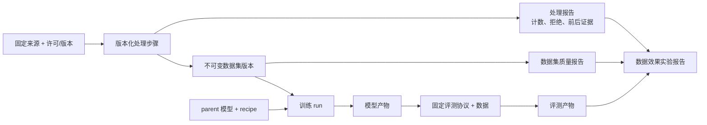

# 数据处理、质量变化与模型效果设计

**状态：** 详细设计；数据处理/静态质量、策略身份、离线预览、实验预登记/保守比较、策略 UI 与定向补数 UI 准备切片已实现；官方 Mini 质量门槛与真实受控训练效果仍未完成
**范围：** 追踪原始数据处理过程，评估每个正式数据集，并检验声明的处理策略是否改变下游模型结果。

处理轨迹、静态质量报告、基础模型/数据血缘、阶段策略、固定 split、离线 preview/build、实验登记与结果汇总、Data UI 策略编辑器均已有实现和 CPU fixture 验证。真实模型效果只有在预登记、精确 lineage、固定预算与评测协议齐备后才会计算；目前小样本示例报告为 `NOT_EVALUATED`。Mini 数据准备度仍有 SFT/Preference 配额和质量项短缺，不等于 Mini 训练基线已完成。实现记录见[数据证据](../implementation/data/DATA_EVIDENCE.md)与[策略实验指南](../guides/POLICY_EXPERIMENT_UI_zh.md)；类型位于 `src/onegpu_posttrain/data/policy.py`、`policy_experiment.py` 和 `src/onegpu_posttrain/lineage.py`。

English: [Data Processing, Quality Change, and Model Effect Design](DATA_PROCESSING_EFFECT_DESIGN.md)。

评测薄弱场景驱动的定向数据工作台已作为提前交付的窄 UI 切片：展示场景分母/来源、编辑 provider/提示词/输出协议草稿、导出未登记配置，并只读显示生成验证与复测摘要。UI 不接收密钥值、不发生成请求、不启动训练；真实执行仍由 CLI 明确控制。它不表示已获得真实 API/GPU 或模型收益证据。完整协议与边界见 [`targeted-synthetic-data`](../../openspec/changes/targeted-synthetic-data/proposal.md) 和[中文操作指南](../guides/TARGETED_SYNTHETIC_DATA_zh.md)。

## 1. 产品问题与边界

用户应能沿着一条证据链查看：

```text
数据来源
  → 有序转换与过滤规则
  → 数据集版本及质量证据
  → 训练 run 与模型产物
  → 固定评测
  → 流水线效果或受控策略比较
```

它回答两个不同的问题：

1. 数据在构建的每一步发生了什么变化，包括删掉了什么、原因是什么？
2. 应用整条处理流水线或某个筛选策略后，在声明的控制条件下，模型指标是否变化？

第一个问题是数据构建观察。第二个问题需要真实训练与评测 run。质量指标变好本身不能证明模型变好，也不能说明模型变化的原因。

本设计扩展[分阶段数据质量设计](DATA_QUALITY_DESIGN_zh.md)、[血缘设计](LINEAGE_DESIGN.md)、冻结的[v0.1.1 数据设计](v0.1.1/01-data-design.md)和[实验设计](v0.1.1/04-experiment-design.md)，不会暗中修改冻结的数据 gate。准入规则或处理顺序变化时，必须显式升级协议版本并重建数据集。

当前可用的完整性门禁为 `python -m onegpu_posttrain validate-lineage --root <artifact-root> --require-complete`。它检查本地身份/摘要/引用及记录完整度；通过不等于数据质量合格、训练复现成功或模型效果有效。普通 JSONL 可以进入训练，但在缺少 manifest 时只形成不完整血缘，不能通过 Mini/OVAT 的完整证据要求。评测比较保留旧分数并提示协议/数据集合不匹配；清洗前后的指标 delta 仅为描述性差异，不能标成清洗带来的因果收益。

## 2. 系统流程与对象职责



| 对象 | 职责 |
|---|---|
| `processing_report.json` | 单次构建的有序步骤、输入输出、带单位计数、首个拒绝原因、可用的逐步质量快照、耗时和引用。 |
| `dataset_manifest.json` | 不可变数据集身份、父数据集、来源/版本/许可、split、内容摘要，以及处理报告和最终质量报告的引用。 |
| `quality_report.json` | 对一个数据集版本按指定协议做出的评估。重新评估会生成新的报告 ID，不改变数据集身份。 |
| `data_effect_experiment.json` | 声明流水线效果或受控策略问题、处理组/对照组数据、模型/recipe/预算/seed/评测契约及兼容规则。 |
| `data_effect_report.json` | 已登记比较的 run/评测结果、数据质量 delta、模型指标 delta、成本和局限。 |

报告采用本地、可搬运的 JSON/Markdown artifact。不要求数据库、托管跟踪服务或第三方数据质量服务。复用项目 canonical Pydantic 记录 schema 和现有 report 写入方式；可选框架 adapter 也必须写入同一契约。

## 3. 数据处理协议与轨迹

### 3.1 每一步的必要语义

每份构建报告包含 `schema_version`、`build_id`、`processing_protocol`、来源引用、创建时间、可用的代码/检查器版本，以及有序 `processing_steps` 数组。开始/结束耗时尚未接入测量时保持不可用。每一步记录：

- 稳定的 `step_id`、顺序、操作名称/版本、操作类型（`transform`、`filter`、`split`、`verify`、`sample`、`tokenize`、`export`）和状态；首个实现由报告级 config digest 绑定整条构建配置；
- 输入/输出引用及**带单位**计数（`raw_rows`、`documents`、`unique_problems`、`examples`、`preference_pairs`、`prompts`、`tokens`）；
- 接收/拒绝数量，以及绑定到已声明规则顺序的 `first_rejection_reasons`；
- 可测量且可比较时的前后指标，每项带方法/版本、分子/分母、抽样方法/覆盖率和状态；
- 可用时的耗时和资源；落盘输出的内容摘要；未知或跳过项的明确原因。

在单位和语义允许时，各计数应能对账。某条规则的拒绝数只代表样本在有序 gate 链中首次失败的规则，不代表该规则独立造成的因果贡献。单位不同或输出并非输入子集时不能计算保留率。配对、分块、packing 和 token 化都可能改变单位。

中间记录不必全部写盘。中间结果实际落盘、复用或被 run 消费时，才分配 `DatasetArtifact` ID 和 manifest。内存数据池使用 `pool:verified_math` 这样的逻辑引用，不伪装成持久数据集。可选的接收/拒绝记录 ID sidecar 不包含源文本，并遵守上游条款。

### 3.2 初始 builder 步骤映射

报告必须记录真实实现顺序，不能假定所有数据 builder 相同。当前 Smoke 实现作为起始映射：

| OpenR1 步骤 | 主要输出/证据 |
|---|---|
| 读取有上限且固定版本的数据行 | 读取行数、来源 revision、达到上限/耗尽/目标停止原因 |
| 规范化问题并生成 `problem_id` | 空/格式错误行、规范化数量 |
| 问题精确去重 | 重复数与稳定 ID |
| Benchmark 去污染 | exact/fuzzy 命中、移除候选数、benchmark revision/协议 |
| 验证器支持的数学核心 | 验证器覆盖/正确性，以及不支持或无正确 trace 的拒绝数 |
| 确定性问题级数据池分配 | SFT/alignment/holdout IDs、seed 和重叠检查 |
| 阶段 builder 与 tokenizer 渲染长度 gate | SFT 合格性、Preference pair 有效性/长度比、GRPO prompt 合格性、holdout 构建 |
| Canonical 序列化/可选 adapter 导出 | 记录数、单位、hash、adapter 来源身份 |

FineMath 顺序不同：读取/检查文本，生成稳定 document ID 并按文档切分，执行二次污染扫描，用固定 tokenizer 分块，再按确定性的前缀兼容 token 预算选取。报告应保留实际顺序；协议变化时升级版本。详见[Smoke 数据构建](../implementation/data/SMOKE_DATA_BUILD.md)和冻结的[数据设计](v0.1.1/01-data-design.md)。

### 3.3 清洗前后指标规则

每一步可以产生轻量质量快照。只有指标定义、单位、评估器/检查器版本和抽样协议兼容时，才比较清洗前后数值。质量变化旁边必须报告覆盖变化：来源/任务/难度、语言、答案类型、长度分层、验证器支持率、少见类别以及总 token/样本量。抽样估计记录样本量和选择方法；未检查的属性标为 `not_measured`，不能写 0。

有些数值是筛选诊断，并非数据集固有质量。例如“被接受样本中的验证器正确率”受验证器和接受条件约束；pair yield 衡量构建效率；GRPO rollout 截断/reward 方差是依赖模型与 recipe 的校准结果，不是静态 prompt 数据属性。报告和 UI 应分开标记这些类别。

## 4. 分阶段数据质量协议

以下是可报告指标菜单；builder 有证据时才输出。每项指标有类别 `dataset_quality`、`build_diagnostic` 或 `model_recipe_suitability`，并标记 `measured`、`estimated`、`not_measured` 或 `not_applicable`。

| 数据产物 | 结构与语义证据 | 覆盖/筛选证据 | 单独的校准或结果 |
|---|---|---|---|
| CPT 语料 | 文档/token 数、编码/schema、空文本、精确重复与注明方法的近重复候选、污染检查 | 过滤前后 source/language/文档长度/token 长度分布；token 预算及 chunk 填充率 | Domain/general PPL 和任务评测属于训练后模型结果，不属于语料报告 |
| SFT | schema、空/错误 prompt/target、解析/格式、验证器覆盖及覆盖范围内正确性、完整度估计/抽查、渲染 token 长度 | 首次 gate 拒绝数；source/problem/difficulty/answer type 分布；unique problem 与 tokens | 下游准确率、格式/解析和稳定性指标 |
| Preference（DPO/SimPO） | pair schema、同题关系、歧义/平局标签；仅当声明标签语义为正确性排序时检查正确性排序，并显示 verifier 覆盖 | 按声明扫描单位计算 pair yield；chosen/rejected 长度比；source/difficulty 分布；train/eval 重叠 | held-out policy-pair accuracy/margin 和任务指标；保留算法特定解释 |
| GRPO prompts | prompt/reference 可解析性、验证器支持/覆盖、预期答案类型、prompt 长度 | 任务/难度/来源组成、unique problem IDs、拒绝原因 | 指定 parent/seed/recipe 的有限 rollout：通过率、非零 reward/组内方差、completion 长度/截断和成本 |
| Evaluation set | 来源/revision/协议、题目覆盖、答案/parser/verifier 覆盖、排除项与评分失败 | 与训练数据的精确/近似重复、祖先/problem ID 重叠、任务/难度/来源组成 | 模型分数是评测结果，不可标成数据质量 |

这里不定义通用质量分或阈值。Gate 结果和后果分开。评估器缺失或验证器不支持时明确标记不可用。数据切分隔离等安全不变量独立于模型效果结论。

## 5. 实验类型与有效性

### 5.1 Pipeline Effect（流水线效果）

比较实际要使用的端到端构建/使用策略与声明的安全基线，保留真实数据量、筛选和资源消耗。它回答“这条流水线实际交付了什么？”数据量、组成和处理可能同时变化，因此模型 delta 是端到端结果，不能归因于单条过滤规则。

### 5.2 Controlled Quality Ablation（受控质量消融）

固定源数据池和评测集，只改变一项声明的筛选/选择策略。对照数据仍须满足 schema、许可、train/eval 分离和污染防护；“raw”不代表可以使用格式错误或泄漏的数据。尽可能匹配训练样本或 token 数、optimizer steps、parent checkpoint、recipe 和 seed。报告仍存在的来源、难度、长度或任务覆盖差异。实验只能估计声明条件下这项策略的影响，不能证明某个质量分与能力普遍相关。

### 5.3 实验登记字段与有效性检查

训练前记录：

```text
experiment_id, question, hypothesis, experiment_type
source_pool_id/revision, control_dataset_id, treatment_dataset_id
processing_policy 与 protocol/config 摘要
parent_model_id/hash, recipe 与 resolved config
budget_type（examples | tokens | optimizer_steps | completions）, budget
seed 列表、evaluation dataset IDs、protocol/evaluator 版本
primary metrics、guardrails、预期资源范围
```

校验器检查评测样本未改变且与训练隔离、parent 和协议匹配、独立变量明确、预算满足声明、dataset manifest/report 可解析、所有 run/evaluation artifact 有血缘。不兼容时返回 `NOT_COMPARABLE` 和原因，不能静默选出赢家。

单卡预算允许时用多个 seed 支持更强结论；单次运行属于描述性结果，必须明确说明。报告绝对值、分母、delta、可用的 seed 间波动、失败/OOM、耗时、tokens/examples 和峰值显存。Loss 和 reward 是训练诊断；能力结论依赖固定 held-out 任务评测和对应任务指标。

### 5.4 候选研究

每组实验都必须保留冻结的数据准入/安全底线。若研究会改变冻结过滤器、pair 选择规则、split 或标签语义，必须先评审并升级数据协议版本、重建 manifest，再开始训练；不能为了让比较更明显而构造无效对照组。

| 研究 | 处理组/对照组 | 固定项 | 主要测量 |
|---|---|---|---|
| SFT 合格数据选择 | 从全部冻结合格样本均匀抽样 vs. 按来源/难度分层抽样；每条数据仍满足冻结 SFT gate | M1 parent、SFT recipe、token/example 预算、评测集、seed | 来源/难度/长度覆盖 + GSM8K/MATH/internal accuracy、格式/解析、稳定性和成本 |
| SFT 重复样本策略（未来协议修订时） | 当前冻结合格集合 vs. 版本化近重复策略 | 同源池、等量预算、parent、recipe、评测 | 重复/覆盖变化 + 任务/格式指标和成本 |
| Preference 负例（版本化策略） | 同题目下，对多个有效 rejected 候选采用不同选择策略 | pair 语义与数量、M2 hash、DPO 或 SimPO objective、beta/config、seed、steps、评测；除非修订协议，否则保留冻结长度规则 | pair 有效性/长度偏差 + held-out policy accuracy/margin 和数学任务指标 |
| GRPO prompt 选择 | 全部冻结合格 prompts vs. 校准后筛选子集 | M2、reward/verifier、生成上限/参数、completion 预算、seed 和评测 | 静态覆盖 + 校准 reward 方差/截断 + 任务准确率与成本 |
| CPT 语料选择（版本化策略） | 固定来源中按策略选择 vs. 等 token 数的嵌套语料 | Base、tokenizer、token 预算、optimizer、序列长度、seed 和评测 | 语料来源/长度/重复证据 + domain/general PPL 和任务指标 |

研究 prompt 筛选时不能同时改 `max_completion_length` 并把结果归因于数据选择；completion 长度是 recipe 变量。Preference correctness 不是 DPO/SimPO 的通用标签定义。CPT 数据量实验的子集应保持嵌套。

## 6. Artifact 契约

建议的本地布局（实际路径可沿用现有 artifact 根目录）：

```text
data/<build_id>/
  reports/processing_report.json
  reports/processing_report.md
  reports/quality/<stage>.json
  manifests/<stage>-smoke-v1.yaml
  canonical/<stage>.jsonl
experiments/data/<experiment_id>/
  data_effect_experiment.json
  data_effect_report.json
  comparison.csv
```

每份报告链接 ID 和内容/配置摘要；路径本身不构成身份。报告仅放汇总证据，不复制完整源记录。每个指标保留 `value`、`unit`、`status`、`class`、method/version、适用时的分子/分母和局限。每项拒绝计数记录单位和 gate 顺序。

处理步骤示例：

```json
{
  "step_id": "s05-verifiable-core-v1",
  "order": 5,
  "operation": "verifiable-core",
  "operation_version": "1",
  "kind": "filter",
  "status": "completed",
  "input_ref": "pool:screened",
  "output_ref": "pool:core",
  "input_count": {"value": 10000, "unit": "unique_problems"},
  "output_count": {"value": 7400, "unit": "unique_problems"},
  "output_is_subset": true,
  "rejected_count": 2600,
  "first_rejection_reasons": {"no_verifier_correct_trace": 2600},
  "unselected_count": 0,
  "unselected_reasons": {},
  "metrics_before": {},
  "metrics_after": {},
  "details": {},
  "limitations": ["Uses upstream correctness_math_verify flags; no fresh verifier execution"]
}
```

数值仅作结构示例。该步骤描述上游标签筛选，不是独立正确性验证或模型提升结果。保留旧 manifest 文件名作为定位入口；内部 dataset ID 关联内容和配置 provenance。

`data_effect_report.json` 记录 `experiment_id`、兼容性结果/原因、对照/处理组 dataset/run/model/eval IDs、指标行（`baseline`、`treatment`、`delta`、单位/分母/方向）、覆盖变化、成本、seed 汇总、局限和结论适用范围。结论仅适用于已测模型/数据/recipe/预算/seed/评测协议。

实验登记示例：

```json
{
  "schema_version": "1.0",
  "experiment_id": "exp-sft-dedup-matched-mini-v1",
  "experiment_type": "controlled_quality_ablation",
  "question": "在 token 预算匹配时，去重是否改变 SFT 任务结果？",
  "source_pool": {"dataset_id": "ds-openr1-sft-pool-v1", "content_digest": "sha256:<digest>"},
  "independent_variable": {"name": "dedup_policy", "control": "exact_dedup_only", "treatment": "exact_plus_near_dedup_v1"},
  "datasets": {"control": "ds-sft-control-v1", "treatment": "ds-sft-dedup-v1"},
  "controls": {"parent_model_sha256": "<digest>", "recipe_sha256": "<digest>", "budget_type": "tokens", "budget": 5000000, "seeds": [42, 43, 44]},
  "evaluation": {"dataset_ids": ["ds-gsm8k-eval-v1", "ds-math500-eval-v1", "ds-internal-holdout-v1"], "protocol_id": "math-eval-v1"},
  "primary_metrics": ["accuracy_at_1"],
  "guardrail_metrics": ["format_rate", "parse_rate", "peak_vram_bytes", "training_seconds"],
  "status": "planned"
}
```

效果报告示例（run 尚未生成前，结果保持不可用）：

```json
{
  "schema_version": "1.0",
  "report_id": "der-exp-sft-dedup-matched-mini-v1",
  "experiment_id": "exp-sft-dedup-matched-mini-v1",
  "comparison_status": "NOT_EVALUATED",
  "compatibility": {"status": "NOT_CHECKED", "reasons": []},
  "arms": {
    "control": {"dataset_id": "ds-sft-control-v1", "run_ids": [], "model_ids": [], "eval_ids": []},
    "treatment": {"dataset_id": "ds-sft-dedup-v1", "run_ids": [], "model_ids": [], "eval_ids": []}
  },
  "data_deltas": [],
  "model_metrics": [{"metric": "accuracy_at_1", "unit": "ratio", "baseline": null, "treatment": null, "delta": null, "denominator": null, "status": "not_measured"}],
  "cost_deltas": [],
  "limitations": ["尚未关联训练或评测 run"]
}
```

数据集 manifest 引用 `processing_report` 和最终 `quality_report`；run lineage 引用实际消费的数据集 manifest/content digest；每个 evaluation 引用精确模型、评测数据集和协议。效果报告按稳定 ID 汇总这些关系，不回写源 artifact。

## 7. UI 与用户工作流

保留现有六页导航。在 Data 和 Stage Comparison 页面扩展能力，不额外建设庞大的平台区域。

1. **找到数据集：** 按阶段/来源/版本搜索，看到最终状态、样本/token 数和血缘。
2. **查看构建过程：** 用紧凑的有序步骤列表浏览；展开后查看输入输出数量、拒绝原因、方法/版本和质量变化。每项指标就地解释分母和局限。
3. **检查覆盖变化：** 比较过滤前后的来源/任务/难度/长度/verifier-support 分布，显式显示缺失类别。
4. **追踪模型结果：** 沿 dataset → run → model → evaluation 查看。若存在数据效果实验，同屏显示处理/对照兼容性、质量/覆盖 delta、模型指标和成本；否则明确标为 `model effect: not evaluated`。
5. **导出/分享：** 链接本地报告/manifest，导出 provenance 完整的 Markdown/JSON 比较；不暴露受限源记录或模型权重。

默认显示摘要表格。流程图作为辅助展示，并提供键盘可访问的表格/列表替代；状态不能只用颜色表示。筛选项包括 source、stage、rule、status 和 experiment type。提供 loading、缺失、过期、格式错误状态。不使用“越干净越好”徽章。将证据标记为 `observed`、`estimated`、`not measured` 或 `not comparable`，并将数据质量与模型结果分开呈现。

## 8. 交付阶段与验收

| 里程碑 | 交付物 | 验收标准 |
|---|---|---|
| 设计 | 本文链接到架构、血缘、质量、实验、UI 和开源计划 | 中英文术语和版本承诺一致；不改变冻结的 v0.1.1 数据语义 |
| Mini 数据构建基础 | 正式 Mini 构建输出 `processing_report.json`、关联 manifest 和最终阶段质量报告 | 固定输入/config 可确定性重建；计数对账；首个拒绝计数有规则顺序/单位；来源版本/IDs/hash 齐全；train/eval 无重叠；不可用指标显式标记 |
| 流水线效果报告 | 真实数据版本连接到对应 run/model/evaluation，并总结端到端结果 | 协议/分母兼容；展示数据量/组成/成本变化；不将结果归因于单一过滤器 |
| 受控研究 | Mini 与必需 OVAT 契约稳定后做一个可选等预算清洗研究；v0.3 建设可复用实验组 | 实验登记通过有效性检查；parent/eval 固定；变量和预算符合声明；结果同时包含数据与模型 delta、seed/不确定性限制及成本 |
| 只读 UI | v0.1.1 UI 展示数据处理轨迹及关联质量/效果视图 | 用完整、部分、缺失、不兼容 artifact 验证；有键盘/表格替代；未知值可见；CLI 仍可独立使用 |

首个可选研究不属于第五个 v0.1 OVAT 或 v0.1 发布门槛。DataTrove/Data-Juicer PoC 仍是可选 adapter，输出必须符合相同契约。

## 9. 风险与保护措施

- **指标漂移：** 协议/版本不匹配时，前后对比无效；标为 `NOT_COMPARABLE`。
- **选择偏差：** 质量变好可能删除少见来源、难题或长样本；始终报告覆盖和 token 体量。
- **模型比较混杂：** 清洗同时改变数据量、recipe、parent 或评测时，归因能力下降；应报告流水线效果，或重新做匹配消融。
- **验证器盲区：** 正确性结论只适用于支持的答案类型；显示 verifier coverage 和不支持样本。
- **因果结论过度：** 单 seed/单数据集不能建立普遍规律；限定结论并说明重复实验不足。
- **隐私/许可暴露：** 默认聚合；可选 ID sidecar 留在本地并遵守许可；公开报告不复制受限源文本。
- **存储/算力成本：** 汇总在内存计算；只物化会复用的数据集；昂贵语义检查和校准使用有预算限制的样本。

## 10. 关联文档

- [产品愿景](PRODUCT_VISION_zh.md)
- [系统架构](SYSTEM_ARCHITECTURE_zh.md)
- [数据质量设计](DATA_QUALITY_DESIGN_zh.md)
- [血缘设计](LINEAGE_DESIGN.md)
- [冻结的数据设计](v0.1.1/01-data-design.md)
- [冻结的实验设计](v0.1.1/04-experiment-design.md)
- [前端页面规格](frontend/PAGE_SPEC_zh.md)
- [开发计划](../project/DEVELOPMENT_PLAN.md)
- [开源发布计划](../project/OPEN_SOURCE_PLAN_zh.md)
